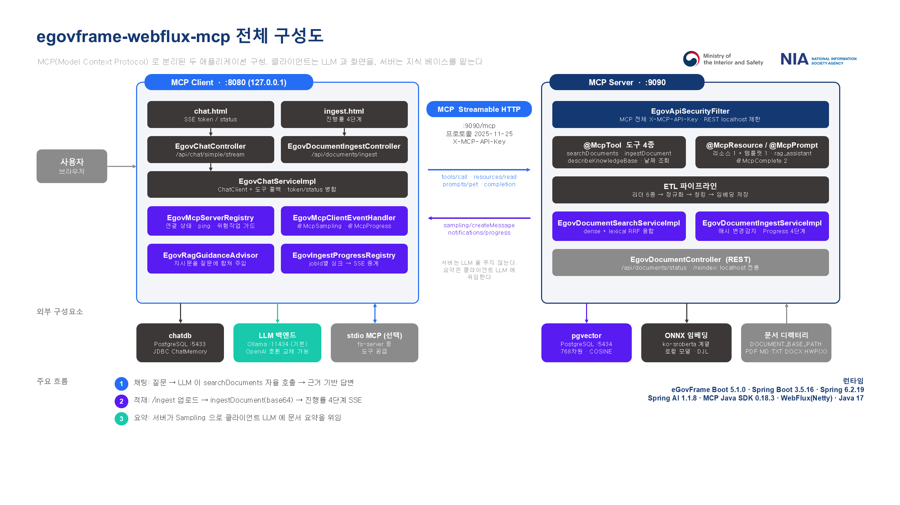
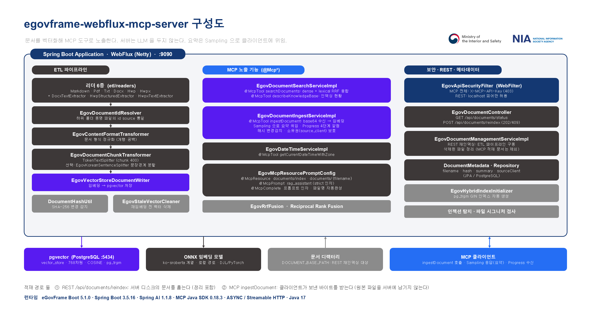
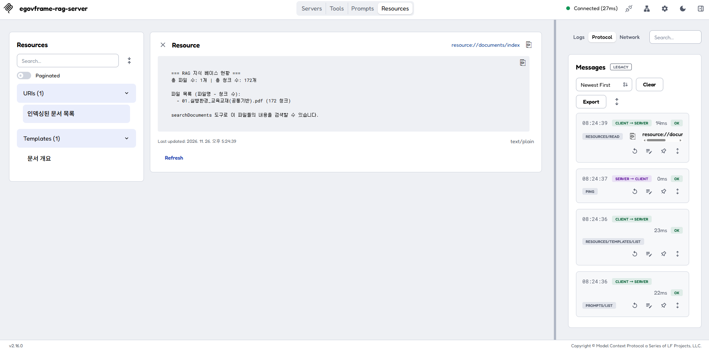
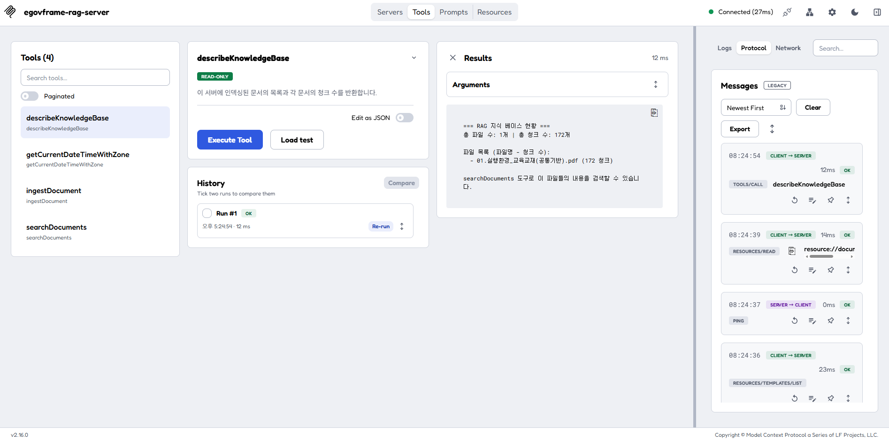
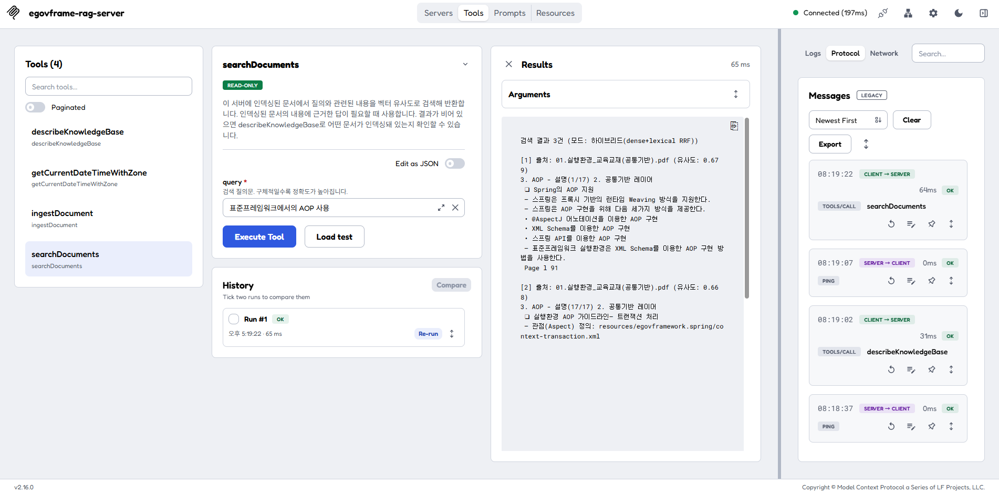

# egovframe-webflux-mcp-server

[![eGovFrame](https://img.shields.io/badge/eGovFrame-5.1.0-134F8C?labelColor=white&logo=%2BPHBhdGggZmlsbD0iI2U0MDMyZSIgZD0iTTE2NC43ODggNjIuNTg5Yy00Ljc3Ny0xNi4wMjYtMjcuMTUzLTQ3LjU3MS02Ny4yODItNDcuNTcxLTM3Ljg5NCAwLTY0LjIxNCAyOC41NjMtNjQuMjE0IDU0LjIxMiAwIDQuNzU5LjI5IDYuOTAxIDEuNDY2IDExLjM2OC0uNDg5LTEuOTUxLS43NC0zLjkwOC0uNzQtNS44MjMgMC0yNi43MjEgMjYuNzQxLTQ1LjIyNyA1NC4yNDgtNDUuMjI3IDM3LjIxOCAwIDY3LjM4OCAzMC4xNzQgNjcuMzg4IDY3LjM5IDAgMjkuMTczLTE2Ljc4NSA1NC40MzctNDEuMTc5IDY2LjU2NXYuMDIzYzMxLjQ1NS0xMS4zOTEgNTMuOTA4LTQxLjUxMiA1My45MDgtNzYuODg0IDAtOC4zNzgtMS4xMjctMTUuNzU5LTMuNTk1LTI0LjA1MyIvPjwvc3ZnPg%3D%3D)](https://www.egovframe.go.kr)
[](https://openjdk.org/projects/jdk/17/)
[](https://spring.io/projects/spring-boot)
[](https://spring.io/projects/spring-ai)
[](https://github.com/pgvector/pgvector)

Spring AI MCP(Model Context Protocol) 기반의 RAG(Retrieval-Augmented Generation) 서버이다.
PDF/마크다운/텍스트/DOCX/HWP/HWPX 문서를 ONNX 임베딩 모델로 벡터화해 PostgreSQL(PGVector)에 저장하고,
MCP 클라이언트의 요청에 따라 문서 검색·적재 도구를 노출한다.

---

## 목차

- [공통 환경](#공통-환경)
- [이 프로젝트 설정](#이-프로젝트-설정)
- [아키텍처](#아키텍처)
- [사전 준비](#사전-준비)
- [빌드 및 실행](#빌드-및-실행)
- [MCP 노출 기능](#mcp-노출-기능)
- [범용 MCP 클라이언트 연결 (VS Code, Cline)](#범용-mcp-클라이언트-연결-vs-code-cline)
- [REST API](#rest-api)
- [접속 URL](#접속-url)
- [보안 구조](#보안-구조)
- [프로젝트 구조](#프로젝트-구조)
- [application.yml 주요 설정](#applicationyml-주요-설정)
- [한국어 문장경계 청킹 (선택 기능)](#한국어-문장경계-청킹-선택-기능)
- [민감정보(PII) 마스킹 (선택 기능)](#민감정보pii-마스킹-선택-기능)
- [트러블슈팅](#트러블슈팅)
- [라이선스](#라이선스)

---

## 공통 환경

| 항목 | 버전 |
| :--- | :--- |
| JDK | 17 |
| 표준프레임워크 실행환경 | 5.1.0 |
| Spring Boot | 3.5.16 |
| Spring AI | 1.1.8 |
| Maven | 3.9.13 |
| Docker | 29.7.2 |

---

## 이 프로젝트 설정

| 항목 | 값 |
|------|-----|
| 서버 포트 | 9090 |
| MCP 타입 | ASYNC / STREAMABLE HTTP |
| 벡터 DB | PostgreSQL + PGVector (localhost:5434, DB: mcpdb) |
| 임베딩 모델 | ONNX (ko-sroberta 계열, 768차원, jar 외부 경로) |
| Swagger UI | http://localhost:9090/swagger-ui.html |

---

## 아키텍처

MCP 로 분리된 두 애플리케이션이 어떻게 맞물리는지, 그리고 이 서버 안이 어떻게 나뉘는지를 보여준다.





---

## 사전 준비

### 1. 인프라 기동 (Docker Compose)

프로젝트 루트에서 실행한다.

```bash
docker compose up -d
```

PostgreSQL(mcpdb:5434)과 pg_trgm 익스텐션이 준비된다(`init-scripts/01-init.sql`).

> 초기화 스크립트는 **DB 데이터가 들어 있는 `mcpdata` 볼륨이 비어 있을 때만** 실행된다(`docker-entrypoint-initdb.d` 규칙).
> 컨테이너만 지우고 다시 만들어도 볼륨이 남아 있으면 실행되지 않으므로, 그 스크립트가 생기기 전에 만든 볼륨에는 pg_trgm 이 없다.
> 하이브리드 검색이 기본 활성이라 이 경우 **lexical 채널이 빠지고 dense 단독으로 동작한다.**
> 기동 로그의 `pg_trgm 확장` WARN 과 검색 시 `lexical 검색 실패` WARN 으로 확인하고, 기존 데이터를 유지하려면 아래 명령으로 확장을 설치한다.
> `docker compose down -v` 로 볼륨을 지우고 다시 만들어도 되지만, 이때는 적재한 데이터도 함께 지워진다.
>
> ```bash
> docker compose exec postgres psql -U postgres -d mcpdb -c "CREATE EXTENSION IF NOT EXISTS pg_trgm;"
> ```

### 2. ONNX 임베딩 모델

모델 파일은 jar 외부 경로에 위치해야 한다. 기본 경로:

- Windows: `%USERPROFILE%\spring-ai-Config\model\`
- Linux/macOS: `~/spring-ai-Config/model/`

필요 파일: `model.onnx`, `tokenizer.json`, `config.json`, `tokenizer_config.json`, `special_tokens_map.json`

> 경로는 환경변수 `EMBEDDING_MODEL_PATH` / `EMBEDDING_TOKENIZER_PATH`로 바꿀 수 있다.

모델은 저장소에 들어 있지 않다. Hugging Face 에 올라와 있는 모델을 아래처럼([uv](https://docs.astral.sh/uv/) 사용) ONNX 로 변환해 위 경로에 두면 된다.

```bash
uv init
uv add huggingface-hub transformers "optimum[onnx]" onnxruntime sentence-transformers accelerate
uv run hf auth login        # 접근 승인이 필요한 모델일 때만
uv run optimum-cli export onnx --model <모델 ID> ./model
# ./model 의 파일 5개를 위 경로로 복사
```

모델의 차원 수(`config.json` 의 `hidden_size`)와 `application.yml` 의 `spring.ai.vectorstore.pgvector.dimensions`(기본 768)는 같아야 한다. 이 프로젝트의 기본 설정은 `jhgan/ko-sroberta-multitask`(768차원)로 확인했다.

모델의 토큰 상한(ko-sroberta 계열은 512)과 `app.document.chunk-size`는 함께 맞춰야 한다. 상한을 넘는 청크는 뒷부분이 잘려 검색되지 않는다. 자세한 내용은 `application.yml`의 `chunk-size` 주석 참고.

### 2-1. DJL 네이티브 라이브러리 (빌드 시 동봉)

임베딩은 ONNX 추론과 별개로 DJL 의 텐서 백엔드(`libtorch`)를 쓴다. 이 프로젝트는 그 네이티브를 `pom.xml` 에 명시해 빌드 산출물에 동봉하므로, 실행 중에 `publish.djl.ai` 에서 약 250 MB 를 내려받는 일이 없다. **폐쇄망에서는 이 동봉이 필수이다.**

**주의:** classifier 는 **빌드하는 OS** 기준으로 자동 결정된다(`win-x86_64` / `linux-x86_64` / `osx-aarch64`). CPU 아키텍처는 보지 않으므로 ARM 기반 Windows·Linux 는 이 자동 선택에 맞지 않는다. 그런 환경에서는 DJL 이 해당 플랫폼용 네이티브를 제공하는지 먼저 확인한다. Windows 에서 빌드한 jar 를 Linux 서버에 올리면 그 서버용 네이티브가 없어 런타임 다운로드로 되돌아가고, 폐쇄망에서는 **처음 임베딩하는 시점**(기동 직후 문서 자동 적재, 또는 첫 적재·검색)에 실패한다. 서버 기동 자체는 성공한다. 빌드 OS 와 실행 OS 가 다르면 대상 OS 를 명시한다.

```bash
mvn package -Ddjl.pytorch.classifier=linux-x86_64
```

Intel Mac 은 `osx-x86_64` 네이티브가 제공되지 않아 동봉이 불가하다.

### 3. 환경변수

| 변수 | 설명 | 기본값 |
|------|------|--------|
| `MCP_API_KEY` | MCP 엔드포인트(`/mcp`) 인증 키 | 빈 문자열 (MCP 요청 전체 차단) |
| `EMBEDDING_MODEL_PATH` | ONNX 모델 파일 전체 경로 | `${user.home}/spring-ai-Config/model/model.onnx` |
| `EMBEDDING_TOKENIZER_PATH` | 토크나이저 파일 전체 경로 | `${user.home}/spring-ai-Config/model/tokenizer.json` |
| `DOCUMENT_BASE_PATH` | 기동 시 자동 적재와 REST 재인덱싱이 훑을 문서 루트 디렉터리 | `${user.home}/egovframe-mcp/docs` |

`MCP_API_KEY`를 설정하지 않으면 빈 문자열이 기본값이 되어 모든 MCP 요청이 차단된다(의도된 안전 기본값). 검색·적재뿐 아니라 `initialize` 도 403이므로 클라이언트가 연결 자체를 못 한다.

### 4. 문서 디렉터리 (기동 시 자동 적재 · REST 재인덱싱 경로)

서버는 기동할 때마다, 그리고 `POST /api/documents/reindex` 를 받을 때 `DOCUMENT_BASE_PATH` 아래의 `**/*.md`, `**/*.pdf`, `**/*.txt`, `**/*.docx`, `**/*.hwp`, `**/*.hwpx` 를 재귀적으로 훑어 바뀐 문서만 적재한다. 미설정 시 기본값은 다음과 같다.

```
${user.home}/egovframe-mcp/docs/
    Windows      C:\Users\{사용자명}\egovframe-mcp\docs\
    Linux/macOS  ~/egovframe-mcp/docs/
```

**경로는 환경변수로 지정한다. `application.yml` 을 직접 고치지 않는다.** `application.yml` 은 git 이 추적하는 파일이라, 각자 자기 경로를 적어 넣으면 그 수정이 커밋에 섞여 들어간다.

```powershell
# Windows (PowerShell): 서버 기동 터미널에서
$env:DOCUMENT_BASE_PATH = "C:/my-docs"
```

```bash
# Linux / macOS
export DOCUMENT_BASE_PATH=/var/lib/mcp/docs
```

디렉터리는 기동 전에 미리 만들어 둔다. 경로가 비었거나 잘못 지정되면 리더는 `마크다운 파일을 찾을 수 없습니다` WARN 만 남기지만, 그 뒤의 삭제된 파일 정리가 **DB 에 남아 있던 이 디렉터리 출처 문서의 벡터·메타데이터를 전부 지운다.** 디스크에 없는 파일을 삭제된 것으로 보기 때문이다. REST 재인덱싱을 호출하지 않아도 **서버를 재기동하면 같은 정리가 일어난다.**

PDF 를 페이지 수가 줄어든 파일로 바꾸면, 사라진 뒤쪽 페이지의 벡터·메타데이터도 이때 함께 지운다.

MCP `ingestDocument` 로 적재한 문서는 `source_client` 조건으로 정리 대상에서 빠지므로 영향을 받지 않는다([`ingestDocument` 상세](#ingestdocument-상세) 참고).

---

## 빌드 및 실행

프로젝트 루트에서 실행한다.

```bash
mvn clean compile
mvn spring-boot:run
```

---

## MCP 노출 기능

### 도구 (Tool)

`@McpTool` 어노테이션으로 자동 등록된다. 모두 `Mono<String>` 반환(ASYNC 서버 필수).

| 도구 이름 | 구현 클래스 | 설명 |
|-----------|------------|------|
| `searchDocuments(query)` | `EgovDocumentSearchServiceImpl` | 벡터 유사도 기반 문서 검색. RAG의 진입점. `app.rag.hybrid.enabled`(기본 `true`)이면 dense 후보의 순위를 pg_trgm lexical 순위와 RRF 로 합쳐 보정한다(lexical 에서만 찾은 문서는 반환하지 않음). `false`면 dense 단독. |
| `describeKnowledgeBase()` | `EgovDocumentSearchServiceImpl` | 인덱싱된 파일 목록과 청크 수 조회. 호출 시점은 클라이언트가 정하며, 도구 설명에 2단계 패턴을 유도하는 문구를 두지 않음. |
| `ingestDocument(ctx, jobId, filename, content, mimeType)` | `EgovDocumentIngestServiceImpl` | 파일 수신 → 임베딩. 요약은 MCP Sampling 으로 클라이언트 LLM 에 위임. Progress는 호출 측이 `progressToken`을 보낸 경우에만 전송(아래 참조). |
| `getCurrentDateTimeWithZone(zoneId)` | `EgovDateTimeServiceImpl` | 지정 타임존의 현재 날짜/시각 반환. |

네 도구 모두 `X-MCP-API-Key` 헤더가 있어야 호출된다. 도구별 검사가 아니라 MCP 엔드포인트 단위로 막는다([보안 구조](#보안-구조) 참조).

#### `ingestDocument` 상세

- **인증**: 이 도구만의 검사는 없다. MCP 엔드포인트 전체가 `X-MCP-API-Key` 를 요구하므로(아래 [보안 구조](#보안-구조)) 키 없는 호출은 HTTP 403으로 막혀 도구까지 오지 않는다.
- **원본 파일 보관 없음**: 클라이언트가 보낸 파일 내용(텍스트는 UTF-8 그대로, 바이너리는 base64)을 처리해 벡터 DB에만 적재하고, 원본 파일을 문서 디렉터리에 보관하지 않는다. 그래서 REST 재인덱싱 대상이 아니다. HWPX 만은 파서가 파일 경로를 요구해 JVM 임시 디렉터리에 원본 바이트를 잠시 쓰고 처리가 끝나면 지운다. 삭제에 실패하거나 프로세스가 비정상 종료되면 임시 파일이 남을 수 있다(삭제 실패는 `[HWPX] 임시 파일 삭제 실패` WARN 으로 남는다). 나머지 형식은 메모리에서만 처리한다.
- **삭제된 파일 정리에서 제외**: `document_metadata.source_client` 에 값이 있는 문서(MCP로 적재한 문서)는 REST 재인덱싱의 삭제된 파일 정리 대상에서 빠진다.
- **Progress**: 4단계(텍스트 추출 → 요약 → 청킹 → 임베딩) 진행률을 `ctx.progress(...)`로 보낸다. **실제 전송은 요청 `_meta`에 `progressToken`이 있을 때만** 일어나고, 없으면 알림을 만들지 않는다. 전용 클라이언트는 토큰을 보내 `/ingest` 화면에 4단계를 표시한다. 토큰을 보내지 않는 범용 클라이언트에서는 진행률만 빠지고 적재는 그대로 된다.
- **Sampling**: 문서 요약을 서버가 만들지 않고 MCP Sampling으로 **클라이언트의 LLM**에 맡긴다. 어느 모델로 요약할지는 클라이언트 설정에 따른다. 클라이언트는 응답의 `model` 값에 실제 모델 이름을 실어 보내지만 서버는 이 값을 저장하지 않는다(전용 클라이언트는 자기 로그에 남긴다).
- **변경 감지**: SHA-256 해시를 비교해 바뀐 부분만 다시 임베딩한다. PDF 는 페이지 단위, 나머지 형식(DOCX·HWP·HWPX·MD·TXT)은 파일 단위로 비교한다.
- **이전 벡터 정리**: 다시 임베딩하기 전에 바뀐 페이지(PDF) 또는 파일의 기존 벡터를 지운다. PDF 의 페이지 수가 줄었으면 사라진 뒤쪽 페이지의 벡터·메타데이터도 지운다.
- **소유권 보호**: 다른 클라이언트가 적재한 문서는 덮어쓰지 않는다(`source_client` 비교).
- **프롬프트 인젝션 탐지**: 텍스트를 추출한 직후 한글·영문 의심 패턴을 검사하고, 걸리면 적재를 거부한다.

### 리소스 (Resource)

| URI | 설명 |
|-----|------|
| `resource://documents/index` | 인덱싱된 파일 목록 (읽기 전용). `describeKnowledgeBase` 도구와 동일 내용. |
| `resource://documents/{filename}` | 파일 하나의 개요: 요약·청크 수·원본 단위 수·적재 시각·적재 경로. 중괄호가 있는 URI 템플릿이므로 `resources/list`가 아니라 `resources/templates/list`에 노출됨. |

`{filename}` 에는 `resource://documents/index` 로 확인한 이름을 그대로 넣는다. 적재 경로에 따라 이름이 달라지므로 OS 상의 파일명을 짐작해 넣지 않는다. REST 재인덱싱은 `EgovDocumentIdResolver` 가 공백을 `-` 로 바꾸고 경로 문자(`\ / : * ? " < > |`)를 제거하므로 OS 파일명과 다르고(괄호는 남는다), MCP `ingestDocument` 는 클라이언트가 보낸 이름을 그대로 쓴다. 한글·괄호가 든 이름은 클라이언트가 퍼센트 인코딩해 보내기도 해서 디코드 전/후 두 형태로 조회한다. 전체 내용은 제공하지 않으므로 본문이 필요하면 `searchDocuments` 도구를 쓴다.

### 프롬프트 (Prompt)

| 이름 | 설명 |
|------|------|
| `rag_assistant` | RAG 지시문 템플릿(문서를 먼저 검색하라는 안내). MCP 메시지의 role 은 `assistant` 로 전달된다. `strict` 파라미터(true/false)로 검색 강제 엄격도 조정. 전용 클라이언트는 이 지시문을 질문에 덧붙여 쓰고, VS Code·Claude Desktop 등에서는 사용자가 직접 불러 쓴다. |

### 자동완성 (Completion)

`@McpComplete` 로 등록되어 `completion/complete` 요청에 응답한다. Completion을 지원하지 않는 클라이언트에서는 쓰이지 않을 뿐, 오류가 되지는 않는다.

| 대상 | 후보 |
|------|------|
| `rag_assistant` 프롬프트의 `strict` 인자 | `true` / `false` |
| `resource://documents/{filename}` 의 `filename` 변수 | 인덱싱된 파일명 중 입력한 접두사로 시작하는 것 |

### MCP Inspector로 동작 확인

[MCP Inspector](https://github.com/modelcontextprotocol/inspector)로 `http://localhost:9090/mcp`에 연결하면 등록된 리소스·도구 목록과 실행 결과를 직접 확인할 수 있다.

**리소스 조회**: `resource://documents/index` 읽기 결과



**도구 호출 1**: `describeKnowledgeBase`로 인덱싱 현황 확인



**도구 호출 2**: `searchDocuments`로 하이브리드(dense+lexical RRF) 검색



---

## 범용 MCP 클라이언트 연결 (VS Code, Cline)

`http://localhost:9090/mcp`를 Streamable HTTP로 등록하면 된다. `X-MCP-API-Key` 헤더를 **반드시 함께** 등록한다. 모든 요청에 필요하므로 없으면 연결 단계에서 403으로 실패한다.

**VS Code Copilot**: `C:\Users\{사용자명}\AppData\Roaming\Code\User\mcp.json`

```json
{
  "servers": {
    "egovframe-webflux-mcp-server": {
      "url": "http://localhost:9090/mcp",
      "type": "http",
      "headers": { "X-MCP-API-Key": "<서버에 설정한 MCP_API_KEY 값>" }
    }
  }
}
```

**Cline**: `cline_mcp_settings.json` (`"type"`을 `"streamableHttp"`로 지정해야 함, `"http"` 아님)

```json
{
  "mcpServers": {
    "egovframe-webflux-mcp-server": {
      "url": "http://localhost:9090/mcp",
      "type": "streamableHttp",
      "headers": { "X-MCP-API-Key": "<서버에 설정한 MCP_API_KEY 값>" },
      "disabled": false,
      "autoApprove": []
    }
  }
}
```

**알아둘 점**
- `headers` 를 빠뜨리면 **연결 자체가 실패한다.** 네 도구 모두 키를 요구하므로 도구 목록도 받지 못한다. 도구별 거부가 아니라 엔드포인트 단위 거부이다.
- `ingestDocument`로 파일을 적재하려면 클라이언트가 로컬 파일을 읽어 `content` 파라미터로 넘겨줘야 한다. 클라이언트에 파일 읽기 기능이 없거나 접근 범위가 제한돼 있으면 `@modelcontextprotocol/server-filesystem`을 함께 등록해 `read_file` 결과를 넘긴다.
  ```json
  "filesystem": {
    "command": "npx",
    "args": ["-y", "@modelcontextprotocol/server-filesystem", "C:/path/to/docs"]
  }
  ```
  지정한 디렉터리가 **하나도 존재하지 않으면** 서버가 기동 즉시 종료하며, 클라이언트에는 `None of the specified directories are accessible` / `Connection closed (-32000)`로 보인다. 경로부터 확인한다.
- 이 경로(모델이 파일을 읽어 `content` 를 채우는 경우)에는 텍스트 파일(`.md`, `.txt`)을 쓴다. 서버는 클라이언트 종류와 관계없이 정상적인 Base64 입력이면 바이너리(`.pdf`, `.docx`, `.hwp`, `.hwpx`)도 받는다. 다만 모델이 Base64 문자열을 대화 안에서 다시 쓰면 바이트가 원본과 달라지기 쉽고, 서버는 파일 시그니처가 확장자와 맞지 않으면 적재를 거부한다. 바이너리 문서는 전용 클라이언트 `/ingest` 업로드나 REST `/api/documents/reindex`를 사용한다. 두 경로는 6종(PDF·DOCX·HWP·HWPX·MD·TXT)을 모두 처리한다.
- **이 경로로 적재한 문서는 원본과 달라질 수 있다.** `ingestDocument`는 파일이 아니라 `content` 문자열을 받으므로, 모델이 파일을 읽어 그 문자열을 채우는 경로에서는 모델이 내용을 다시 쓴다. **문자 수가 일치해도 내용이 다를 수 있어** 글자 수로는 확인되지 않는다. 원본 그대로 적재해야 하면 REST `/api/documents/reindex` 또는 전용 클라이언트 `/ingest` 업로드를 사용한다. 두 경로는 코드가 파일 바이트를 읽어 넘긴다.
- **Sampling 지원 여부는 클라이언트마다 다르다.** 서버는 적재 시 문서 요약을 MCP Sampling으로 클라이언트 LLM에 위임한다. 지원하지 않는 클라이언트에서도 **적재 자체는 정상 동작하며** 요약만 생략된다(이때 `document_metadata.summary`에 `(Sampling 미지원)`이 저장된다). 서버 로그 `[Sampling] 클라이언트 Sampling 미지원`으로 확인할 수 있다.
- **Progress는 `progressToken`을 보내는 클라이언트에만 전달된다.** 범용 클라이언트는 대개 토큰을 보내지 않으므로 진행률 없이 적재만 된다(정상 동작). 이때 서버 로그에 남는 `Progress notification not supported by the client!` 경고는 요청에 토큰이 없을 때 출력되는 문구이며, **클라이언트의 지원 여부와는 무관하다.**

### 폐쇄망에서 stdio MCP 서버 준비하기

`npx -y`(Node)나 `uvx`(Python) 같은 실행기는 필요한 패키지가 캐시나 로컬에 없으면 **실행 시점에 내려받으므로** 폐쇄망에서는 실패한다. 캐시를 미리 채우고 오프라인 옵션으로 실행하는 방법도 있지만, 여기서는 반입 파일과 실행 경로를 분명히 관리할 수 있도록 실행기를 거치지 않고 미리 반입한 파일을 직접 가리키는 방법을 설명한다. `command` 를 `node`, `python`, 실행 바이너리로 바꾸고 `args` 첫 항목에 반입한 파일의 절대 경로를 준다.

```json
{
  "mcpServers": {
    "filesystem": {
      "command": "node",
      "args": [
        "C:/mcp-offline/node_modules/@modelcontextprotocol/server-filesystem/dist/index.js",
        "C:/path/to/docs"
      ]
    }
  }
}
```

반입 절차는 [폐쇄망에서 stdio MCP 서버 준비하기](docs/offline-stdio-mcp-server.md) 에 있다. 순수 JS 인지 판별하는 방법, 진입점 확인, `node_modules` 전체 반입과 단일 파일 번들의 비교, 네이티브 모듈·Python·Docker 기반 서버에서 각각 무엇을 더 반입해야 하는지를 설명한다.

---

## REST API

MCP 경로(`/mcp/**`)와 별개로 서버 파일시스템 문서를 관리하는 REST API이다.

| 메서드 | 경로 | 인증 | 설명 |
|--------|------|------|------|
| `GET` | `/api/documents/status` | localhost 전용 | ETL 진행 상태 조회 |
| `POST` | `/api/documents/reindex` | localhost 전용 | 서버 로컬 문서 전체 재인덱싱 (202/409) |

> localhost 전용 경로는 외부 IP에서 호출 시 `EgovApiSecurityFilter`가 403을 반환한다. 판정은 **연결을 맺은 상대 주소**로만 한다. `X-Forwarded-For` 는 클라이언트가 임의로 넣을 수 있어 보지 않는다. 리버스 프록시 뒤에 두면 모든 요청이 프록시 주소에서 들어오므로, 어느 주소에서 온 요청까지 localhost 로 볼지 먼저 정해야 한다.
>
> 문서 파일 추가는 서버의 `DOCUMENT_BASE_PATH` 디렉터리에 직접 복사 후 `/api/documents/reindex` 호출로 적재하거나, MCP `ingestDocument` 도구(텍스트는 UTF-8, 바이너리는 base64 전송)를 사용한다.

---

## 접속 URL

| 용도 | URL |
|------|-----|
| MCP 엔드포인트 | `http://localhost:9090/mcp` |
| Swagger UI | `http://localhost:9090/swagger-ui.html` |
| 인덱싱 상태 | `http://localhost:9090/api/documents/status` |

---

## 보안 구조

`EgovApiSecurityFilter`(WebFilter) 하나가 두 규칙을 적용한다.

| 규칙 | 대상 | 조건 | 거부 |
|------|------|------|------|
| A. localhost 제한 | `POST /api/documents/reindex`, `GET /api/documents/status` | **직접 연결된** 원격 주소가 `127.0.0.1`/`::1` | 403 |
| B. MCP 키 | MCP 엔드포인트 전체 (`/mcp`) | 유효한 `X-MCP-API-Key` 헤더 | 403 |

규칙 B는 도구마다가 아니라 **MCP 엔드포인트 전체**에 적용된다. 검색·조회·리소스·프롬프트·적재가 모두 키를 요구하며, 키가 없으면 `initialize` 부터 403이라 연결 자체가 실패한다. MCP Inspector 등으로 점검할 때도 헤더를 먼저 등록해야 한다.

403 본문은 JSON-RPC 오류로 보내며, 실패 사유를 세 가지로 구분해 알려준다. 서버에 키 미등록, 헤더 없음, 값 불일치이다. 고쳐야 할 곳이 서버인지 클라이언트인지 가려 주기 위한 것이며, 키 값 자체는 응답에도 로그에도 남기지 않는다.

키 검사에 실패하면 401 대신 403을 보낸다. MCP 인증 규격에서 401은 OAuth 흐름을 시작하라는 신호이다. 이 서버는 고정 공유키를 쓰고 OAuth를 제공하지 않으므로, 401을 보내면 규격을 따르는 클라이언트가 없는 메타데이터를 찾다가 "로그인이 필요하다"는 오류를 띄운다.

환경변수 `MCP_API_KEY` 가 비어 있으면 모든 MCP 요청이 막힌다. 의도된 기본값이다.

### 키를 여러 개 등록하기

`api-keys` 는 목록이고 유효한 값 중 하나와 일치하면 통과한다. 키 값은 운영자가 정해 서버에 등록하고, 같은 값을 클라이언트의 `X-MCP-API-Key` 헤더에 넣는다. 사용자가 여러 명이면 사람·클라이언트별로 따로 정한다. 하나가 유출됐을 때 그 키만 지우면 된다. 키별로 쓸 수 있는 도구를 나누지는 않으므로, 유효한 키는 검색뿐 아니라 적재 도구도 호출할 수 있다.

```yaml
app:
  security:
    api-keys:
      - "${MCP_API_KEY:}"          # 전용 클라이언트
      - "${MCP_API_KEY_VSCODE:}"   # VS Code 사용자
```

단, **키는 접근을 막을 뿐 누가 보냈는지는 가려내지 못한다.** 적재 문서의 소유권 판정에 쓰는 `source_client` 는 MCP 연결 때 클라이언트가 스스로 알리는 이름(`initialize` 요청의 `clientInfo.name`)이다. 전용 클라이언트에서는 `app.mcp-client-id` 설정값이 이 이름이 된다. 같은 이름을 보내는 클라이언트는 같은 출처로 취급된다. 그래서 유효한 키를 가진 쪽은 남의 이름을 달고 보낼 수 있다. 소유권 보호는 실수로 남의 문서를 덮어쓰는 것을 막아 주고, 일부러 다른 이름을 달고 보내는 것은 막지 못한다.

---

## 프로젝트 구조

```
src/main/java/com/example/webflux/
├── McpServerApplication.java
├── config/
│   ├── EgovAsyncConfig.java                  # 비동기 스레드풀
│   ├── EgovCommonConfig.java
│   ├── EgovHybridIndexInitializer.java       # pg_trgm GIN 인덱스 자동 생성 (hybrid.enabled=true 시)
│   ├── EgovMcpResourcePromptConfig.java      # @McpResource, @McpPrompt, @McpComplete 등록
│   └── SecurityProperties.java               # app.security.api-keys 바인딩
├── controller/
│   └── EgovDocumentController.java           # REST /api/documents/**
├── dto/
│   └── DocumentStatusResponse.java
├── etl/
│   ├── readers/                          # EgovMarkdownDocumentReader, EgovPdfDocumentReader, EgovTxtDocumentReader,
│   │                                     #   EgovDocxDocumentReader, EgovHwpDocumentReader, EgovHwpxDocumentReader,
│   │                                     #   EgovDocxTextExtractor, EgovHwpStructuredExtractor, EgovHwpxTextExtractor(본문 추출),
│   │                                     #   EgovDocumentIdResolver(하위 폴더 동명 파일 id/source 통일)
│   ├── transformers/                     # EgovContentFormatTransformer, EgovDocumentChunkTransformer, EgovKoreanSentenceSplitter(선택),
│   │                                     #   EgovPiiMaskingTransformer(선택, 민감정보 마스킹)
│   └── writers/                          # EgovVectorStoreDocumentWriter
├── model/
│   └── DocumentMetadata.java             # JPA 엔티티 (filename, hash, sourceClient 등)
├── repository/
│   └── DocumentMetadataRepository.java
├── security/
│   └── EgovApiSecurityFilter.java            # WebFilter: REST localhost 제한 + MCP 엔드포인트 API 키 검증
├── service/
│   ├── EgovDateTimeService.java
│   ├── EgovDocumentIngestService.java
│   ├── EgovDocumentManagementService.java
│   ├── EgovDocumentSearchService.java
│   └── impl/
│       ├── EgovDateTimeServiceImpl.java               # @McpTool: getCurrentDateTimeWithZone
│       ├── EgovDocumentIngestServiceImpl.java         # @McpTool: ingestDocument
│       ├── EgovDocumentManagementServiceImpl.java     # REST reindex 처리 (ETL 파이프라인)
│       └── EgovDocumentSearchServiceImpl.java         # @McpTool: searchDocuments, describeKnowledgeBase
└── util/
    ├── DocumentHashUtil.java              # SHA-256 해시 계산
    ├── DocumentIngestFailedException.java
    ├── DocumentOverwriteForbiddenException.java
    ├── EgovFileSignatureValidator.java         # 확장자와 실제 바이트가 맞는지 검사
    ├── EgovKoreanSentenceSupport.java          # 한국어 문장 경계 판정 유틸 (EgovKoreanSentenceSplitter가 사용)
    ├── EgovPromptInjectionDetector.java       # 자연어 프롬프트 인젝션 패턴 탐지
    ├── EgovRrfFusion.java                     # Reciprocal Rank Fusion (하이브리드 검색)
    ├── EgovStaleVectorCleaner.java            # 재임베딩 전 기존 벡터 삭제
    ├── FileSignatureMismatchException.java
    ├── PromptInjectionDetectedException.java
    └── UnsupportedFileTypeException.java      # 미지원 파일 형식 예외
```

---

## application.yml 주요 설정

```yaml
spring:
  ai:
    mcp:
      server:
        type: ASYNC
        protocol: STREAMABLE
        instructions: |                 # 연결 즉시 클라이언트에 전달되는 서버 사용 안내
          이 서버는 RAG 지식 베이스 검색과 문서 적재를 제공합니다.
          - searchDocuments: 질문에 관련된 문서 청크를 벡터 유사도로 검색
          - ingestDocument: PDF/DOCX/HWP/HWPX/MD/TXT 적재
          # 전문은 application.yml 참고
        streamable-http:
          keep-alive-interval: 30s      # idle 연결 유지
    embedding.transformer.onnx:
      modelUri: file:${EMBEDDING_MODEL_PATH:${user.home}/spring-ai-Config/model/model.onnx}
    vectorstore.pgvector:
      dimensions: 768
      distance-type: COSINE_DISTANCE

server:
  port: 9090

app:
  security:
    api-keys:
      - "${MCP_API_KEY:}"               # 빈 문자열은 유효 키로 불인정 → MCP 요청 전체 차단
  rag:
    similarity-threshold: 0.30
    top-k: 5
    hybrid:
      enabled: true                     # dense + lexical RRF 융합 검색 (false면 dense 단독)
      lexical.word-similarity-threshold: 0.30
  document:
    base-path: ${DOCUMENT_BASE_PATH:${user.home}/egovframe-mcp/docs}
    path: file:${app.document.base-path}/**/*.md
    pdf-path: file:${app.document.base-path}/**/*.pdf
    txt-path: file:${app.document.base-path}/**/*.txt
    docx-path: file:${app.document.base-path}/**/*.docx
    hwp-path: file:${app.document.base-path}/**/*.hwp
    hwpx-path: file:${app.document.base-path}/**/*.hwpx
    chunk-size: 400
    min-chunk-size-chars: 350
    max-num-chunks: 500
    min-chunk-length-to-embed: 50
    chunking:
      korean-sentence:
        enabled: false                  # true 시 문장경계 인지 스플리터(EgovKoreanSentenceSplitter) 사용
    normalization:
      normalize-newlines: true          # true면 문단 경계(빈 줄) 규칙 무력화. 아래 "한국어 문장경계 청킹" 참고

springdoc:
  paths-to-exclude: /mcp/**            # Swagger에서 MCP 경로 제외
```

---

## 한국어 문장경계 청킹 (선택 기능)

기본은 Spring AI `TokenTextSplitter`(토큰 수 기준 균등 분할)이다.
`app.document.chunking.korean-sentence.enabled: true`로 켜면 `EgovKoreanSentenceSplitter`가
한국어 종결어미·마크다운 블록·코드펜스 경계를 우선 보존하며 분할한다.

| 항목 | 내용 |
|------|------|
| 기본값 | `false` (기존 동작 유지) |
| 적합한 문서 | 한국어 위주 문서 |
| 부적합할 수 있는 경우 | 영어 비중이 높은 문서 (영어 문장 끝 마침표는 경계로 보지 않아 구간이 길어질 수 있음) |
| 오버랩 | 없음 (기존 `TokenTextSplitter`와의 정합을 위해 의도적으로 생략) |

> **주의**: `app.document.normalization.normalize-newlines: true`(기본값)이면 연속 개행이 정규화 단계에서
> 미리 1개로 축약되어 빈 줄 기준 문단 경계 규칙이 동작하지 않는다. 마크다운 블록 시작·코드펜스 경계·문장 종결
> 경계는 이 설정과 무관하게 정상 동작하지만, 문단 경계까지 온전히 쓰려면 `normalize-newlines: false`로 내려야 한다.

활성화 여부는 기동 로그의 `TextSplitter 설정 - splitter: EgovKoreanSentenceSplitter, ...`로 확인할 수 있다.

---

## 민감정보(PII) 마스킹 (선택 기능)

문서를 벡터 DB에 넣기 전에 주민등록번호·카드번호·인증키를 토큰으로 바꾼다.
`searchDocuments` 결과는 범용 MCP 클라이언트(VS Code, Claude Desktop 등)의 모델에도 전달되고, 그 모델은 외부 클라우드 LLM일 수 있다.
서버는 그 경로를 통제할 수 없으므로, 원문을 저장하지 않는 것으로 보호한다.
규칙은 [egovframe-ai-rag](https://github.com/eGovFramework/egovframe-ai-rag) 의 `spring-ai-rag-redis-stack` 에 있는 PII 마스킹과 같다.

```yaml
app:
  document:
    pii-masking:
      enabled: false        # 기본 비활성
      mask-rrn: true        # 주민등록번호/외국인등록번호 (검증자리 통과분만)
      mask-card: true       # 카드번호 (Luhn 통과분만)
      mask-secret: true     # api_key=..., password: ... 형태의 값
      account-regex: ""     # 계좌번호 정규식. 비우면 계좌 마스킹 안 함
```

| 대상 | 규칙 | 토큰 |
|------|------|------|
| 주민등록번호/외국인등록번호 | 6자리-7자리(성별 1~8), 검증자리까지 맞아야 치환. 검증자리가 틀린 관리코드 등은 그대로 둔다 | `[RRN]` |
| 카드번호 | 13~19자리, Luhn 검사 통과분만. 주민번호 형태의 13자리는 제외 | `[CARD]` |
| 인증키/비밀키 | 키 이름은 남기고 값만 치환. 값이 6자 이상이고 한글이 없으며 숫자·기호를 포함할 때만 | `[SECRET]` |
| 계좌번호 | `account-regex`를 지정했을 때만 | `[ACCOUNT]` |

전화번호·이메일·담당자명·주소는 마스킹하지 않는다. 업무 검색에 필요한 정보라서 가리면 검색 적중률이 떨어진다.

두 경로 모두 정규화 뒤, 청크로 나누기 전 문서 단위로 한 번 적용한다. 경로마다 달라지는 것은 그 결과를 어디에 쓰는지이다.

| 경로 | 위치 | 이유 |
|------|------|------|
| MCP `ingestDocument` (전용 클라이언트 `/ingest` 포함) | 정규화 뒤, Sampling 요청 전에 한 번 | Sampling이 문서 내용을 클라이언트 LLM에 보내기 전에 가리고, 같은 마스킹본을 저장에도 쓴다. 요약도 마스킹본으로 만들어져 메타데이터와 응답에 저장된다 |
| REST 재인덱싱 | 정규화 뒤, 한 번 | 이 경로에는 Sampling이 없어 원문이 밖으로 나갈 자리가 없다 |

마스킹이 일어난 문서의 메타데이터에는 `pii_masking_applied: true`가 붙는다.
청크로 나누기 전 문서 단위로 붙이므로, 그 문서의 청크는 치환된 값이 없는 청크까지 모두 같은 값을 갖는다.

> **주의**
> - 켜기 전에 적재한 문서는 바뀌지 않는다. 변경 감지 해시가 원문 기준이라 파일이 그대로면 '변경 없음'으로 건너뛴다. 기존 문서를 마스킹본으로 바꾸려면 해당 문서의 `document_metadata` 행을 지운 뒤 다시 적재한다.
> - 2020년 10월 이후 발급된 무작위 외국인등록번호는 검증자리 규칙을 따르지 않아 마스킹되지 않을 수 있다.
> - 숫자·기호가 없는 영문 전용 비밀번호는 마스킹되지 않는다. 영문 낱말만으로 된 값까지 잡으면 안내문의 일반 문장이 함께 가려지므로 그 조건을 뺐다.
> - `mask-rrn`만 끄고 `mask-card`를 켜 두면 구분자 없는 13자리 주민번호가 원문으로 남을 수 있다. `mask-rrn`만 따로 끄지 말 것.
> - 마스킹 패턴은 숫자 사이 구분자로 ASCII 공백과 하이픈만 받는다. HWP·PDF에서 뽑은 텍스트에 섞여 나오는 전각 공백(U+3000)·비줄바꿈 공백(U+00A0)·제로폭 문자로 끊긴 번호는 정규화가 그 문자를 ASCII 공백으로 바꾼 뒤에야 걸린다. 그래서 두 경로 모두 정규화 뒤에 마스킹한다. `app.document.normalization.enabled`를 false로 두면 그런 번호가 마스킹되지 않은 채 Sampling 요청과 저장에 쓰인다.
> - 이 기능은 위 표의 패턴만 치환하는 보조 수단이다. 모든 민감정보가 외부 LLM으로 나가지 않게 막아 주지는 않는다.
> - `account-regex`는 운영자가 설정 파일에 직접 적는 값이라 서버가 따로 검사하지 않는다. 입력 길이에 따라 검사 시간이 급격히 늘어나는 정규식(ReDoS)을 넣지 않도록 주의한다.

---

## 트러블슈팅

| 증상 | 원인 | 해결 |
|------|------|------|
| 기동 실패: `Failed to cache the resource: file:...model.onnx` | ONNX 모델 파일 누락. `TransformersEmbeddingModel` 이 `InitializingBean` 이라 **기동 시점에** 읽음 | `%USERPROFILE%\spring-ai-Config\model\`에 모델 파일 복사, 또는 `EMBEDDING_MODEL_PATH` 로 경로 지정 |
| PGVector 연결 오류 | PostgreSQL 미기동 | `docker compose up -d` 실행 |
| MCP 연결·적재 인증 실패 (403) | 서버 `MCP_API_KEY` 미설정 또는 클라이언트가 보낸 키 불일치 | 전용 클라이언트는 서버와 같은 값으로 `MCP_API_KEY` 환경변수를 맞춘 뒤 재기동. 범용 클라이언트는 설정 파일의 `X-MCP-API-Key` 헤더 값을 서버 값과 맞춤 |
| 인덱싱 중 409 Conflict | 재인덱싱 이미 진행 중 | `/api/documents/status` 확인 후 완료 대기 |
| Sampling 요약 미생성 | 클라이언트의 LLM 백엔드가 응답하지 않거나, 클라이언트가 Sampling 미지원 | 클라이언트 쪽 LLM 기동·설정 확인. 서버는 자체 모델이 없어 대체 생성하지 않음. 어느 쪽이든 적재 자체는 성공하고 `document_metadata.summary` 에 사유가 괄호 문구로 남음(`(Sampling 미지원)` · `(요약 실패)` 등). |
| 하이브리드 검색 결과 수 < topK | RRF 결과 중 lexical 전용 문서는 본문 없어 제외 | 정상 동작. `app.rag.top-k` 를 늘리거나 `app.rag.hybrid.weight.dense` 를 올리면 제외된 뒤에 남는 결과 수가 늘어날 수 있음. dense 유사도 하한(`app.rag.similarity-threshold`)을 넘는 문서가 적으면 늘지 않음. |
| Swagger에 MCP API 없음 | 의도된 동작 | `/mcp/**`는 Swagger 제외. `/api/documents/**`만 표시. |
| 문서와 무관한 질문에도 `searchDocuments` 가 호출됨 | `rag_assistant` 지시문을 따르는 정도가 모델마다 다름. 같은 지시문으로도 호출하는 모델과 하지 않는 모델이 있음 | 서버에서 막을 수 없음. 도구 호출 여부는 모델이 정하고 서버는 지시문만 내려줌. 다른 모델로 바꾸거나, 클라이언트에서 지시문 적용을 끄고 질의. |

---

## 라이선스

이 프로젝트는 Apache License 2.0 을 따른다. 전문은 [LICENSE.txt](LICENSE.txt) 에 있다.

사용한 기술 스택의 라이선스는 다음과 같다.

| 기술 스택 | 라이선스 | 상용 사용 가능 여부 | 비고 |
| :--- | :--- | :--- | :--- |
| **Spring Boot · Spring AI** | Apache 2.0 | 가능 |  |
| **MCP Java SDK** | MIT | 가능 |  |
| **PostgreSQL · PGVector 확장** | PostgreSQL License | 가능 |  |
| **JDBC 드라이버 · pgvector 자바 클라이언트** | BSD 2-Clause · MIT | 가능 |  |
| **Hibernate ORM** | LGPL 2.1 | 가능 | 고치지 않고 라이브러리로 쓰는 경우. 아래 참고 |
| **DJL** | Apache 2.0 | 가능 |  |
| **PyTorch 네이티브(libtorch)** | BSD 3-Clause | 가능 | 빌드 산출물에 동봉한다. 아래 참고 |
| **ONNX Runtime** | MIT | 가능 | 임베딩 모델의 라이선스는 별도 확인 필요 |
| **Apache POI** | Apache 2.0 | 가능 |  |
| **hwplib · hwpxlib** | Apache 2.0 | 가능 |  |
| **AspectJ** | EPL 2.0 | 가능 | 의존만 하므로 재라이선스 의무 없음 |

### 주의사항

- **PyTorch 네이티브는 빌드 산출물에 함께 들어간다.** `pytorch-native-cpu` jar 에는 라이선스
  파일이 들어 있지 않으므로, 이 프로젝트의 산출물을 다시 배포할 때는 PyTorch 의 BSD 3-Clause
  저작권 고지를 함께 싣는다. 「사전 준비 → DJL 네이티브 라이브러리」 참고.
- **ONNX 임베딩 모델은 이 저장소에 없다.** 모델 파일은 각자 받아 jar 외부 경로에 두며, 모델마다
  라이선스가 다르므로 따로 확인한다.
- **Hibernate ORM 은 LGPL 2.1 이다.** 이 프로젝트는 고치지 않고 그대로 의존하므로 이 프로젝트의
  라이선스에는 영향이 없다. 실행 jar 에 담아 배포할 때는 교체할 수 있는 형태를 유지한다.
